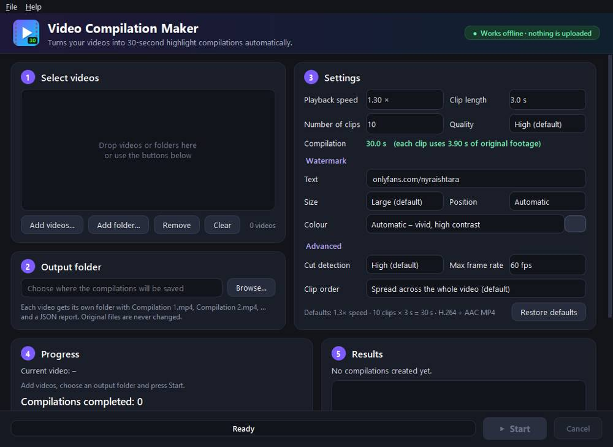

# Video Compilation Maker

A Windows desktop application that turns your own videos into **30-second highlight
compilations** automatically: 10 clips × 3 seconds, sped up 1.3×, watermarked with
`onlyfans.com/nyraishtara`, as many compilations per video as the footage allows —
**without ever reusing the same footage twice**.

Everything runs on your laptop. The program works offline, needs no account, API key or
subscription, and never uploads your videos anywhere.



*The main window, captured from the packaged `VideoCompilationMaker.exe` on the Windows
build machine. [After a run](docs/screenshot.png) the Results list shows each compilation
with a thumbnail.*

---

## 1. Download and install

Go to the repository's **[Releases](https://github.com/nasya-y/video-clip/releases)** page and
download one of:

| File | What it is |
|---|---|
| `VideoCompilationMaker-Setup-1.0.3.exe` | **Installer (recommended).** Installs for your Windows user only (no administrator rights needed), adds a Start-menu entry and optionally a desktop icon, and can be removed from *Settings → Apps*. |
| `VideoCompilationMaker-1.0.3-portable-win64.zip` | Portable version. Unzip anywhere and double-click `VideoCompilationMaker.exe`. |

Everything is bundled (Python runtime, Qt, OpenCV, FFmpeg 9.0) — you do **not** need to
install Python, FFmpeg or anything else. Windows 10 or 11, 64-bit. The installer is about
105 MB; the installed program needs about 400 MB of disk space.

The same files are also attached to every successful run of the
[*Windows build and test* workflow](https://github.com/nasya-y/video-clip/actions/workflows/windows-build.yml)
(*Artifacts* section; you must be signed in to GitHub, and artifacts expire after 90 days).

> **SmartScreen warning.** The program is not code-signed (that requires a paid certificate),
> so the first time you run it Windows may say *"Windows protected your PC"*.
> Click **More info → Run anyway**.

## 2. How to use it

1. **Select videos** – *Add videos…*, *Add folder…* (all videos directly inside that folder)
   or drag and drop files/folders onto the list. Common formats work: MP4, MOV, MKV, AVI,
   WMV, WEBM, MTS/M2TS, TS, 3GP, FLV, MPG, … File names with spaces and non-English
   characters are fine. Files without a seek index (camcorder MTS/M2TS, TS, MPG/VOB) — or
   any file in which seeking turns out not to land on the right frame — are read through a
   temporary copy with a seek index (the streams are copied, nothing is re-encoded), so
   every clip is cut from exactly the right place.
2. **Output folder** – choose where the compilations are saved.
3. **Settings** – the defaults already follow the rules below. You can change speed, clip
   length, number of clips, quality, and the watermark (text, size, position, colour).
4. Press **▶ Start**. The progress bar, the current video and stage, the number of finished
   compilations and any problems are shown while it works. The window stays responsive.
5. **Results** – double-click a compilation (or press *▶ Preview*) to play it, *Open output
   folder* to see the files, *Report* to open the JSON report.
6. **Cancel** stops safely: finished compilations are kept, the one being rendered is
   discarded (it is never left half-written). Press *Start* again later to continue where it
   stopped — numbering continues and already-used footage is never reused.

Your last settings and folders are remembered automatically.

## 3. What happens to each video

### Speed
The 1.3× speed-up is applied to the **entire source timeline before clips are selected**:
every frame time is divided by 1.3 and clips are chosen as exact 3.0-second windows on this
sped-up timeline (= 3.9 s of original footage each). Each chosen window is rendered from the
original file with the speed change applied exactly once (video `setpts=PTS/1.3`, audio
`atempo=1.3`, which keeps the pitch and stays in sync). No intermediate sped-up copy of the
whole video is encoded — that would only add an extra generation of quality loss and take
much longer; the result is identical to cutting the windows from a fully sped-up copy.
The verification step measures the speed in the finished file to prove it was applied once.

### Clip selection
* The **whole video is decoded and analysed**, not just the beginning.
* **Cuts and jump cuts** are detected frame by frame (colour change, pixel change, dense
  optical flow and the motion-compensated residual, with adaptive thresholds so subtle jump
  cuts in static footage are found while camera moves are not mistaken for cuts).
* **Camera shake is not a cut.** For every possible cut the program measures how the whole
  picture moved (shift, rotation, zoom) and undoes that movement. If the two frames then show
  the same picture and the movement looks physical — motion blur, movement spread over
  neighbouring frames, or the camera swinging back — it is handheld, walking or running
  shake and the footage stays usable. A sharp jump that happens between two frames, stays,
  and is far larger than the camera's normal movement (an editor's reframe or zoom
  punch-in) is still treated as a jump cut, as is any change that undoing the camera
  movement does not explain (for example people jumping position after a time skip).
* **Dissolves and fades** are found with a blend test, and **black/blank** and **frozen**
  frames are excluded. A small safety margin is kept around every cut.
* Every clip is one continuous, uninterrupted piece of footage.
* Clips are ranked by **loudness** (the audio level of the section) and **visible movement**
  (optical-flow subject + camera motion), which weigh equally, then by **sharpness**,
  **exposure** and contrast; the planner uses any spare footage to pick the loudest, most
  active positions. Videos without sound are ranked by movement and picture quality.
* Clips start on exact source frames (frame-accurate trimming, correct for variable-frame-rate
  phone videos).

### Order, maximum output and no reuse
* Inside a compilation the 10 clips are always in **chronological order** of the source.
* The planner first computes the **maximum number of complete compilations** the eligible
  footage allows, then fills them. By default every compilation samples the whole video
  (*Clip order → Spread*); alternatives are *Best clips first* and *Consecutive sections*.
* An **allocation ledger** (inside the JSON report) records every source interval used. No
  interval is ever used twice for the same source video — not within a run, not after
  cancelling and resuming, not after changing settings.
* If the remaining footage is not enough for another complete compilation, no incomplete
  compilation is made; the report says how much usable footage is left and how many more
  clips would be needed.
* When verification finds a problem in a clip, only that clip's footage is set aside and the
  compilation is planned again with other footage; processing carries on until the footage
  is used up. If most clips of a compilation fail at once, the problem is not the footage, so
  none of it is set aside.
* The results screen shows, for every video, how many compilations were made and **the most
  the whole video can give** ("3 compilation(s) in total (at most 3 possible)"), with the
  reason: how much of the video is usable after leaving out cuts and transitions, how many
  3.9 s clips that holds, and any footage set aside by verification. The same numbers are in
  the report under `capacity`.

### Watermark
* Exactly the configured text (default `onlyfans.com/nyraishtara`), in a bold clean font
  (Poppins Bold) with a dark outline and a soft drop shadow, large enough to read
  (about 6 % of the frame height by default), visible for the full 30 seconds.
* **Colour**: chosen automatically from vivid high-contrast colours (neon green, bright cyan,
  vivid yellow, hot pink, electric orange, electric lime) by measuring the footage behind the
  watermark; white is only used if it is clearly more visible. One colour, style and position
  per compilation.
* **Position**: chosen automatically among the four corners and top/bottom centre to avoid
  faces (YuNet face detector), the main action (motion map) and busy detail.
* After rendering, the watermark is **verified** in every second frame of the finished file:
  the exact glyph shapes must be present at the expected place and colour with readable
  contrast. If it is hard to read, the style is strengthened (other colour, thicker outline,
  then a dark backing plate) and the compilation is rendered again.

### Automatic checks before a compilation counts as complete
Opens and decodes without errors · H.264 video + AAC audio (when the source has audio) ·
exactly 10 clips · 3 s per clip (±1 frame, no accumulated drift) · 30 s total ·
1.3× speed applied once (measured) · every output frame matches the planned source frames
· clips in chronological order · no cut, transition, black or frozen frame inside any clip
(independent re-check) · no overlap with footage of any other compilation of that video ·
audio length = video length and audio in sync (±40 ms) · watermark text, colour, position,
size and readability.

If a check fails, the faulty footage is rejected and the compilation is rebuilt from other
eligible footage (or re-rendered); a failed compilation is never written as a finished file.

## 4. Output

For every source video a folder named after the video is created in your output folder:

```
Output folder/
  My holiday clip/
    Compilation 1.mp4
    Compilation 2.mp4
    Compilation 3.mp4
    Compilation report.json
```

`Compilation report.json` contains: source file name, path, duration and technical details;
speed applied and how; detected cuts, transitions and skipped sections with reasons; for every
compilation the file name, duration, the source and sped-up-timeline intervals of all 10 clips
with motion/sharpness/exposure scores, the watermark text/colour/position/size, and all
verification results; the allocation ledger; warnings/errors; and how much eligible footage is
left unused. A sample is in [`docs/sample-output`](docs/sample-output).

Output files are standard MP4 (H.264 High profile + AAC 48 kHz, `faststart`), same
resolution and aspect ratio as the source, constant frame rate equal to the source frame
rate (capped at 60 fps by default). HDR sources (HLG as recorded by iPhones, PQ/HDR10) are
tone-mapped to normal SDR so they look right everywhere; interlaced camcorder footage is
deinterlaced; phone videos with rotation metadata come out upright.
Your original files are only read, never modified, moved or deleted.

## 5. Settings and defaults

| Setting | Default |
|---|---|
| Playback speed | 1.3× |
| Clip length (final output) | 3 s |
| Clips per compilation | 10 |
| Compilation length | 30 s |
| Output quality | High (H.264 CRF 18, preset medium, AAC 192 kbit/s) |
| Watermark text | `onlyfans.com/nyraishtara` |
| Watermark size / position | Large / Automatic |
| Watermark colour | Automatic – vivid, high contrast (or a custom colour) |
| Watermark style | Bold text with dark outline and drop shadow |
| Cut detection | High (also: Normal, Maximum) |
| Glass effect | Off — press the button to switch it **On**: a fluted (reeded) glass look over the whole picture, with vertical glass ribs that blur and refract the video. The watermark stays sharp on top. Verification compares the output with the source seen through the same glass. |
| Clip order | Spread across the whole video |
| Max frame rate | 60 fps |
| Output format | MP4 (H.264 + AAC when the source has audio) |
| Original files | never modified or deleted |

*Restore defaults* resets everything except your folders.

## 6. Troubleshooting

| Problem | What to do |
|---|---|
| "Windows protected your PC" | *More info → Run anyway* (the app is not code-signed). |
| A video is reported as unreadable | The file is damaged or not a video. The other videos are still processed. Try re-saving it with another program. |
| "0 compilations" or fewer than expected | Each compilation needs ten uncut 3.9 s sections. The results screen says how many compilations the whole video can give and why ("at most N possible"); the report lists every detected cut (`analysis.cuts`) and the camera shakes that were *not* counted as cuts (`analysis.camera_shake_not_counted_as_cut_s`). *Maximum* cut detection also treats small sharp camera jolts as possible jump cuts — use *High* (default) or *Normal* for shaky handheld footage. |
| "already contains compilation files but no report" | The output folder has `Compilation N.mp4` files without their `Compilation report.json`. Move those files away (or restore the report) so footage cannot be reused by mistake. |
| I want to redo a video from scratch | Delete or rename that video's output folder, then start again. |
| Not enough disk space | Free some space; a 30-second 1080p compilation is typically 20–60 MB. |
| Processing is slow | Long 4K videos take time because every frame is analysed. The progress bar shows an estimate. Results of the analysis are cached, so a second run on the same video starts much faster. |
| Something else | *Help → Open log folder* and look at `app.log` (`%LOCALAPPDATA%\VideoCompilationMaker\logs`). |

Settings are stored in `%LOCALAPPDATA%\VideoCompilationMaker\settings.json`; the analysis
cache and temporary files are in the same folder (temporary files are cleaned up
automatically).

### Command line (optional)
`VideoCompilationMaker-cli.exe` (installed next to the main program) runs the same engine
without the window:

```
VideoCompilationMaker-cli.exe --cli -i "D:\Videos" -o "D:\Compilations"
VideoCompilationMaker-cli.exe --self-test "%TEMP%\vcm-selftest"   (generates a test video and checks everything)
VideoCompilationMaker-cli.exe --help
```

## 7. Building from source

The release files are built automatically by GitHub Actions on a Windows runner
(`.github/workflows/windows-build.yml`): it runs the full test suite on Windows, builds the
program with PyInstaller, runs the packaged program's self-test and a GUI start-up test,
builds the installer with Inno Setup, installs it silently, runs the installed program,
uninstalls it, and uploads the installer, the portable ZIP and the test results.

To build on your own Windows PC:

```powershell
# Python 3.12 (64-bit) and Inno Setup 6 installed
git clone https://github.com/nasya-y/video-clip.git
cd video-clip
py -3.12 -m venv .venv
.venv\Scripts\activate
pip install -r requirements.txt -r requirements-dev.txt
python packaging\fetch_ffmpeg.py              # downloads the FFmpeg build into vendor\ffmpeg
python packaging\collect_licenses.py
python -m PyInstaller packaging\vcm.spec --noconfirm --distpath dist --workpath build\pyinstaller
& "C:\Program Files (x86)\Inno Setup 6\ISCC.exe" packaging\installer.iss
# -> dist\VideoCompilationMaker\VideoCompilationMaker.exe and dist\VideoCompilationMaker-Setup-1.0.3.exe
```

Run from source without packaging: `pip install -e .` then `python -m vcm`
(FFmpeg must then be on the PATH or in `vendor\ffmpeg\bin`).

## 8. Tests

```
pip install -r requirements.txt -r requirements-dev.txt
python -m pytest -v
```

The suite generates synthetic videos with known ground truth (hard cuts, subtle jump cuts,
dissolves, fades, black and frozen sections, camera pans/zoom, realistic handheld/walking/running
camera shake with motion blur, 24/25/29.97/30/50/60 fps
and variable frame rate, landscape/portrait/anamorphic/rotated, with and without audio, audio
beeps for sync checks) and covers: short sources (no compilation), exactly one and multiple
compilations, frame rates and resolutions, audio/no audio and A/V sync against the known beep
times, cut detection and exclusion of unsuitable footage, footage reuse prevention across
compilations and runs, watermark rendering/visibility/verification (including rejecting a wrong
or missing watermark), cancellation and resuming, corrupt/empty/audio-only/truncated inputs,
HDR (PQ and HLG) and other codecs/containers (HEVC/MOV, VP9+Opus/WebM, MJPEG+PCM/AVI,
H.264+AC-3/M2TS, MPEG-2/MPG, interlaced H.264, files with cover art), shaky handheld footage
yielding every possible compilation, verification failures being replaced without stopping
early, the GUI (offscreen) and the command line.

Results are in [`docs/test-results`](docs/test-results): the full suite passes on Linux and
on the Windows build machine (`pytest-linux.txt`, `pytest-windows.txt`, JUnit XML), and
`windows-packaging-and-install-log.txt` shows the packaged `.exe` and the installed program
each processing a test video with every verification check passing. A sample compilation,
its report and a contact sheet are in [`docs/sample-output`](docs/sample-output).

## 9. What has and has not been verified

* **Verified automatically on Windows** (GitHub Actions `windows-latest`, Windows Server):
  the whole test suite; building the `.exe`; the packaged `.exe` starting its window and
  completing a full self-test (analysis, rendering, all verification checks) with the bundled
  FFmpeg; building the installer; silent installation, running the installed program's
  self-test, and uninstalling.
* **Not verified:** I could not run the program on a physical Windows 10/11 laptop with a
  monitor, or on your own videos. All automated tests use synthetic videos with known cuts,
  motion, audio and timing, because no real footage was available to me.
* **Cut detection** is automatic image analysis, not human judgement. On the test material it
  found every hard cut, jump cut, dissolve and fade, with no false cuts in continuous camera
  motion or in shaky handheld, walking and running footage with motion blur (tested at
  24–60 fps). In shaky footage a small reframe (under about 10 times the camera's normal
  movement per frame) cannot be told apart from shake and is treated as shake. A very subtle reframe of a nearly featureless background (≈3 % shift) can still be
  missed at the default *High* setting — use *Maximum* for heavily edited videos.
* **"Interesting action / clear subject"** is approximated by motion (optical flow),
  sharpness, exposure and contrast. The program does not understand what is in the picture.
* **Watermark text check** compares the exact rendered letter shapes (pixel pattern) in the
  output with the expected text, rather than using OCR.
* The program is **not code-signed**, so SmartScreen shows a warning on first start.

## 10. Project layout

```
src/vcm/            application package
  analysis.py       full-length frame analysis, cut/transition detection, quality scores
  selection.py      clip planning on the sped-up timeline (max compilations, no reuse)
  render.py         FFmpeg render graph (exact frames/samples, speed, watermark overlay)
  watermark.py      watermark style, automatic colour/position, rendered-output verification
  verify.py         automatic quality checks of each compilation
  pipeline.py       orchestration, retries, resume, cancellation, reports
  report.py         JSON report + allocation ledger
  gui/              PySide6 interface (background worker thread)
  cli.py            command line, self-test, GUI smoke test
  synth.py          synthetic test-video generator with ground truth
tests/              automated tests
packaging/          PyInstaller spec, Inno Setup script, FFmpeg download, licence collection
resources/          font, face-detection model, icons
```

## 11. Licences

Video Compilation Maker is MIT-licensed. It bundles FFmpeg (GPL v3), Qt/PySide6 (LGPL v3),
OpenCV (Apache 2.0), NumPy (BSD), Pillow (MIT-CMU), the Poppins font (OFL 1.1) and the YuNet
model (MIT). See [`THIRD_PARTY_NOTICES.md`](THIRD_PARTY_NOTICES.md); full licence texts are
installed with the program.
